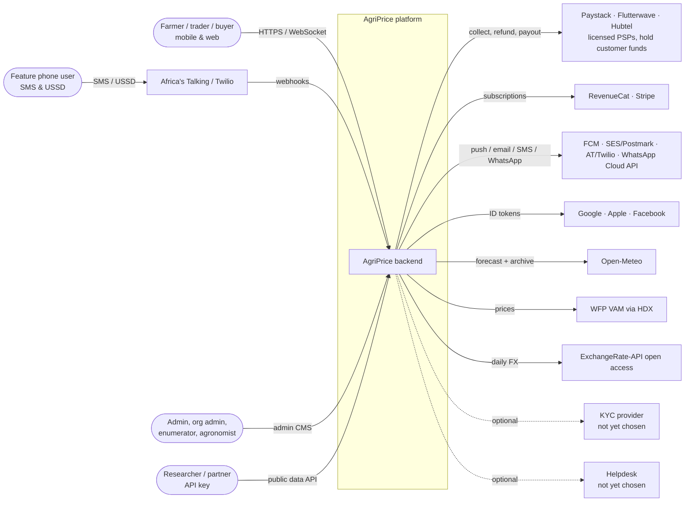
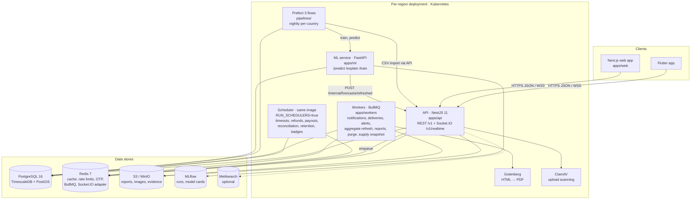
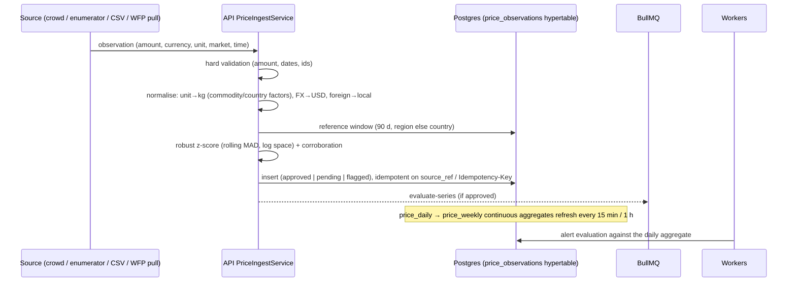
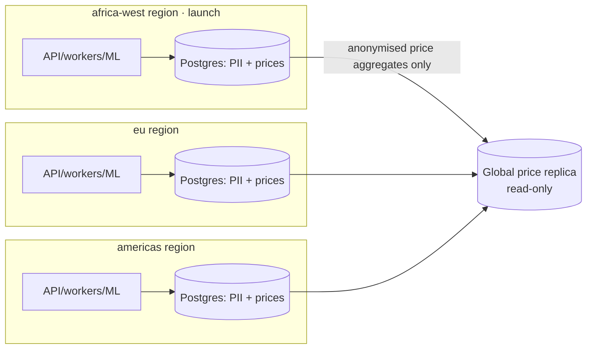

# AgriPrice architecture

AgriPrice is a market-intelligence platform for agriculture. It collects crop prices, forecasts them,
and serves them to farmers, traders, buyers, agencies and partners through mobile, web, SMS/USSD
and a public data API. It launches in Ghana (AgriPrice GH). Every other country is added as a
**country pack** (data, not code).

This document describes the system **as built** on `feat/backend-foundation`. Where a requirement is
not yet implemented it is marked **(planned)** and listed in [cross-cutting-status.md](cross-cutting-status.md).

## 1. System context (C4 level 1)

## 2. Containers (C4 level 2)

| Container | Tech | Responsibility |
|---|---|---|
| `apps/api` | NestJS 11, TS strict, Drizzle + raw SQL | All REST endpoints (208 operations in `openapi/openapi.yaml`), Socket.IO gateway, webhooks, validation, auth |
| scheduler | same image as API | Order timeouts, PSP refunds/payouts, KYC handoff, daily reconciliation, message retention, weekly badges |
| `apps/workers` | Node 22, BullMQ | Notification fan-out + provider delivery, alert evaluation, CAGG refresh, report rendering, account purge, supply snapshots |
| `apps/ml` | Python 3.12, LightGBM, XGBoost, SHAP | Training, rolling-origin backtests, batch prediction, admin `/predict` `/explain` |
| `pipelines` | Prefect 3 | Nightly per-country flow, FX, WFP prices, weather |
| `packages/contracts` | OpenAPI 3.1 + generated TS types | Single source of truth for clients; CI fails on drift |

## 3. Key flows

### 3.1 Price ingestion (one path for every source)

### 3.2 Nightly forecasting

`pipelines/flows/nightly.py`, per active country: FX → WFP (Mondays) → weather (2nd of month) → data-quality
clean-up → CAGG refresh → features on a weekly panel → rolling-origin CV vs seasonal naive → promote if it beats
the baseline → batch predict with guardrails → SHAP → write `forecast_runs/points/explanations` →
`POST /internal/forecasts/refreshed`, which clears caches and triggers an alert sweep.

### 3.3 Marketplace payment (see [state-machines.md](state-machines.md))

Checkout splits the cart into one order per seller and reserves stock. The buyer pays the PSP, and the PSP webhook
is verified and re-checked with the PSP. The order moves to `paid_in_escrow` and the ledger posts
`psp_clearing → escrow`. Delivery and confirmation (or the auto-release timeout) post `escrow → seller + platform_fees`.
Payouts debit the seller balance and are executed by the PSP.

## 4. Cross-cutting design

| Concern | As built | Notes |
|---|---|---|
| API style | `/v1`, cursor pagination, RFC 9457 problem+json, ISO 8601 UTC, `Accept-Language`, `X-Currency`, `X-Unit` | ETag and the `X-Units` header name are planned |
| AuthN | argon2id, OTP (Redis, hashed), OAuth ID-token verification, 15 min JWT + rotating refresh with reuse detection, TOTP | Socket.IO uses the same JWT |
| AuthZ | Global JWT guard, role guard, entitlement guard, per-country scoping in services | Postgres RLS is planned |
| Money | Decimal strings end to end, DB-enforced balanced ledger | PSPs hold funds |
| Async | BullMQ with deterministic job ids (idempotent), exponential backoff | |
| Config | Country packs in DB (`countries.config`, catalogue tables) seeded from `/country-packs` | |
| Residency | Single-region Terraform today | Per-jurisdiction deploys are planned (§5) |

## 5. Deployment and data residency (target)

Each jurisdiction runs its own stack (`infra/terraform` with `env` + `region`). Users, auth, messaging, orders and
payments never leave their region. Only anonymised price data (`price_daily` / `price_weekly` aggregates, no
`submitted_by`, location or notes) replicates to a global read replica for cross-country comparison. **(planned)**
