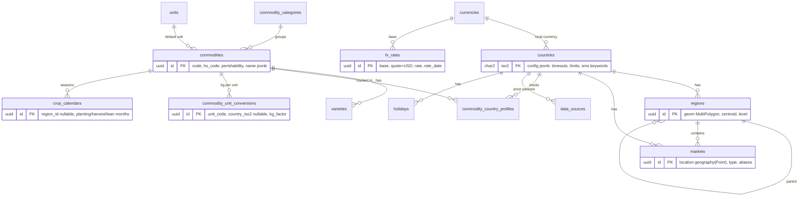
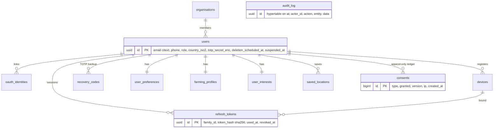
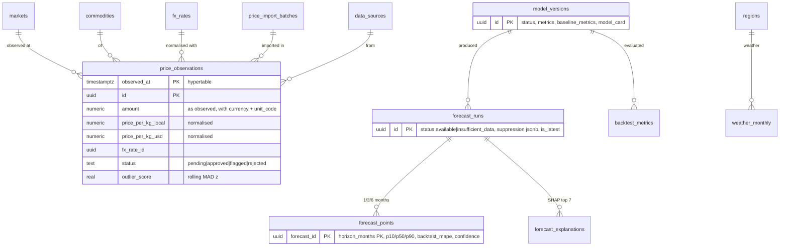
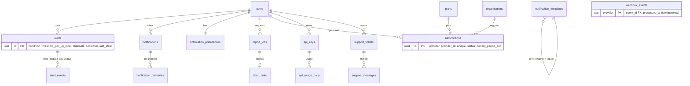
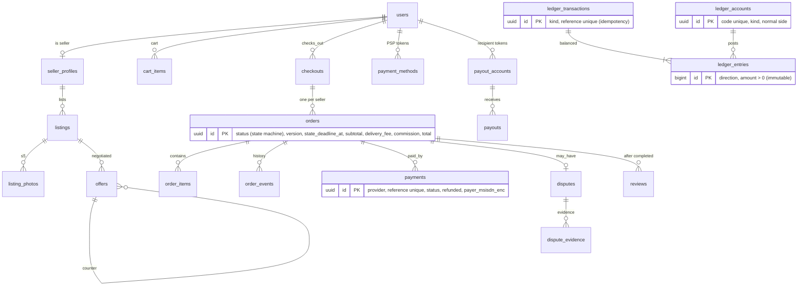
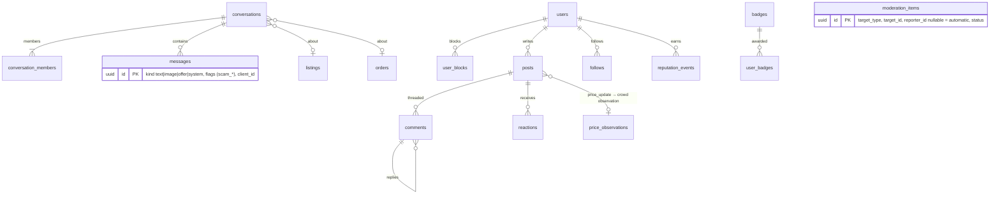
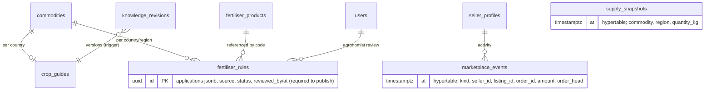

# Data model

PostgreSQL 16 with TimescaleDB and PostGIS. DDL lives in reversible SQL migrations (`apps/api/migrations/NNNN_*.up.sql`
and `.down.sql`). The diagrams show keys and the columns that matter for understanding. See the migrations for everything else.

**Hypertables:** `price_observations`, `audit_log`, `marketplace_events`, `supply_snapshots`.
**Continuous aggregates:** `price_daily` → `price_weekly` (hierarchical), `seller_daily`, `listing_daily`, `demand_weekly`.

## 1. Reference data and geography (country packs)

## 2. Identity, preferences, consent and audit

## 3. Prices, forecasts and insights

Also: `price_daily` / `price_weekly` (CAGGs), `aggregate_watermarks`, `macro_monthly`, `export_prices`,
`export_requirements`, `agro_advice_rules`, `pipeline_runs`.

## 4. Alerts, notifications, content, support, platform

Also: `feedback`, `issue_reports`, `success_stories`, `faqs`, `help_articles`, `app_config`, `sms_inbound`.

## 5. Marketplace, payments and ledger

Also: `commission_rules`, `reconciliation_runs`, view `ledger_balances`.

## 6. Messaging, moderation, community

## 7. Knowledge and seller analytics

Also: `pest_diseases`, `programmes`, `training_items`, `input_suppliers`.

## Conventions
- UUID v4 primary keys (`gen_random_uuid()`). Hypertables include the time column in their primary or unique keys.
- Money is `numeric`. The API returns decimals as strings.
- Localised text is `jsonb {locale: text}` with fallback exact → language → `en`.
- Soft state uses `status` columns. Hard deletes happen only for account purge (financial records keep an anonymised tombstone user).
