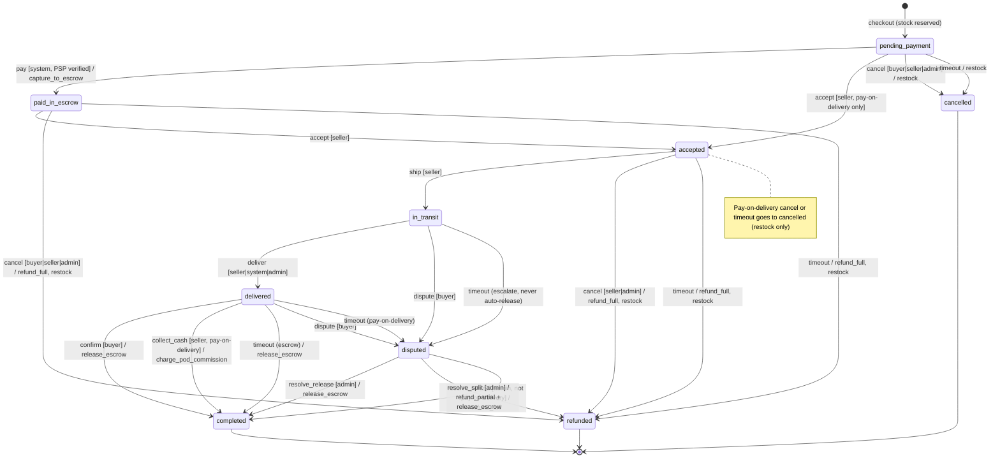
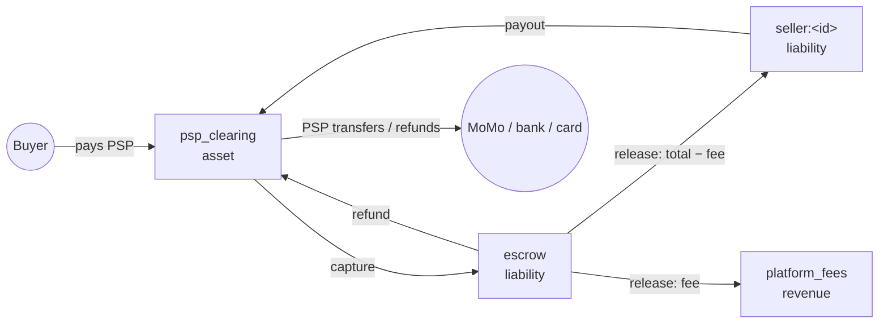
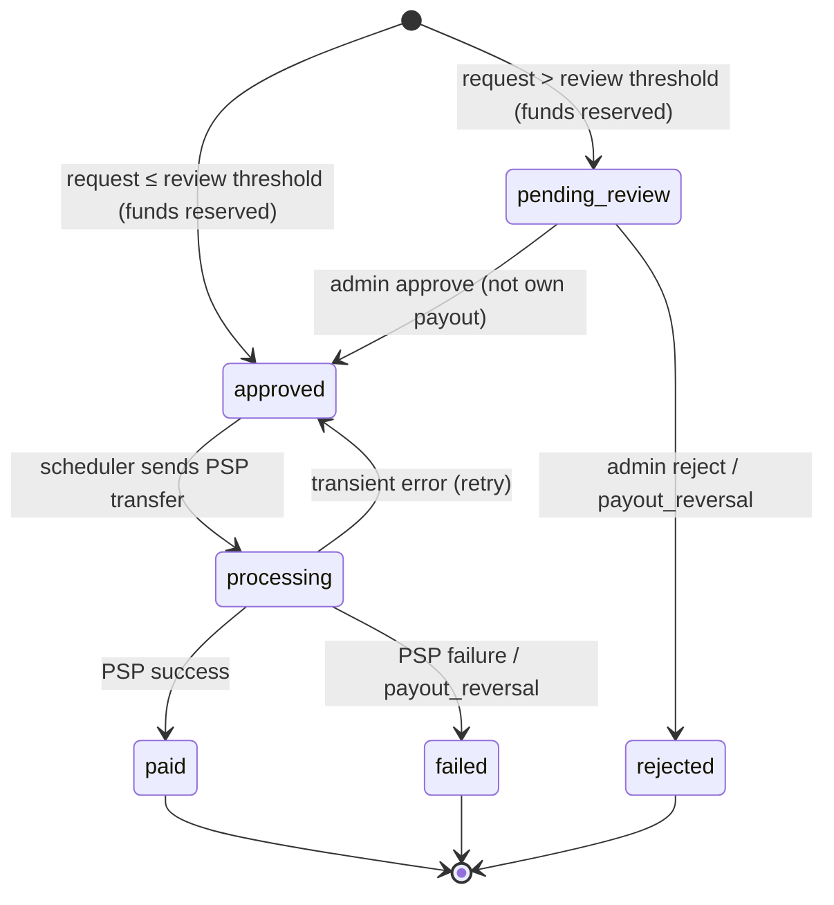
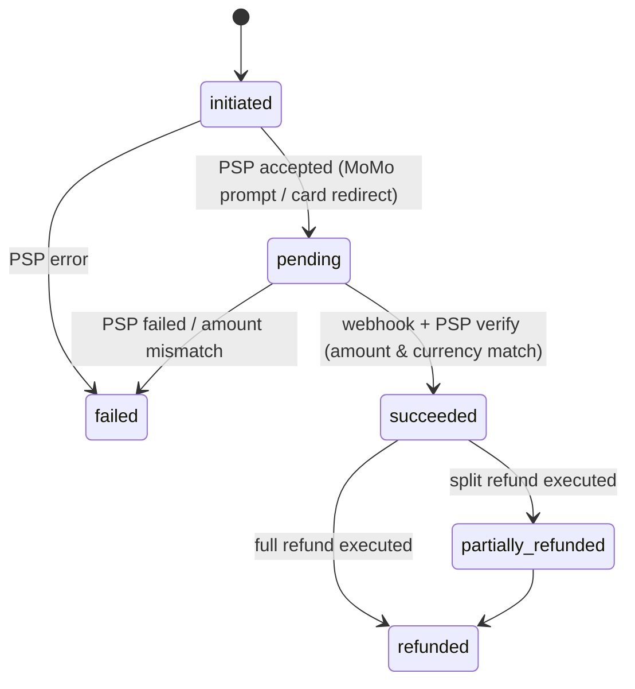

# Order and ledger state machines

> **Status: needs your sign-off.** These diagrams are drawn from the code that already exists
> (`apps/api/src/modules/marketplace/order.machine.ts`, `apps/api/src/modules/payments/ledger.logic.ts`,
> migration `0009_commerce`). If you change anything here, the code and its tests change to match.

## 1. Order

### Timeouts (per country, `countries.config.order_timeouts`; Ghana values are placeholders)

| State | Default | On expiry |
|---|---|---|
| `pending_payment` | 30 min (pay-on-delivery: 48 h for the seller to accept) | `cancelled` |
| `paid_in_escrow` | 48 h for the seller to accept | `refunded` |
| `accepted` | 5 days to ship | `refunded` (pay-on-delivery: `cancelled`) |
| `in_transit` | 14 days | `disputed` (a person decides) |
| `delivered` | 3 days with no dispute | `completed` + escrow release (pay-on-delivery: `disputed`) |
| `disputed` | none | waits for an admin |

### Rules
- **One writer.** Every change goes through `OrdersService.apply`: a row lock (`FOR UPDATE`), an optional `expectedVersion`
  check, the pure state machine, then ledger postings, stock changes and the `order_events` row, all in **one transaction**.
  PSP refunds and notifications run after commit through idempotent jobs.
- Only PSP webhooks (as `system`) can mark an order paid, and only after the payment is re-verified with the PSP
  (amount and currency must match).
- Admins resolving a dispute can't be the buyer or seller. Reviews are allowed only after `completed`.

## 2. Ledger

Double-entry, per currency. Customer money sits in the PSP's licensed settlement account. The ledger records
whose money it is. Accounts are created on first use.

| Account code | Kind | Normal side | Meaning |
|---|---|---|---|
| `psp_clearing:<provider>:<CUR>` | asset | debit | Funds held for us by the PSP |
| `escrow:<CUR>` | liability | credit | Buyer funds awaiting release or refund |
| `seller:<userId>:<CUR>` | liability | credit | Owed to the seller (paid out on request) |
| `platform_fees:<CUR>` | revenue | credit | Commission earned |

### Postings per event

| Event (order effect) | Debit | Credit | Idempotency reference |
|---|---|---|---|
| Payment captured | `psp_clearing` total | `escrow` total | `capture:<paymentId>` |
| Escrow release | `escrow` total | `seller` total − commission; `platform_fees` commission | `release:<orderId>` |
| Full refund | `escrow` total | `psp_clearing` total | `refund:<orderId>` |
| Split resolution | `escrow` refund part → `psp_clearing`; `escrow` remainder → `seller` + pro-rata `platform_fees` | | `refund:<orderId>`, `release:<orderId>` |
| Pay-on-delivery commission | `seller` commission (balance may go negative = owed) | `platform_fees` commission | `podfee:<orderId>` |
| Payout requested (funds reserved) | `seller` amount | `psp_clearing` amount | `payout:<payoutId>` |
| Payout failed or rejected | `psp_clearing` amount | `seller` amount | `payout_reversal:<payoutId>` |
| Late payment (order already timed out) | capture, then immediate refund | | `capture:<paymentId>`, `refund:late:<paymentId>` |

### Invariants (enforced)
1. **Balanced.** A deferred constraint trigger rejects any transaction whose debits ≠ credits per currency.
2. **Immutable.** UPDATE and DELETE on `ledger_entries` raise an error. Corrections are reversing transactions.
3. **Idempotent.** `ledger_transactions.reference` is unique, so replaying a webhook, timeout job or retry never double-posts.
4. **Escrow nets to zero** for every finished order (completed or refunded). Unit-tested in `ledger.logic.spec.ts`.
5. **Commission** = the most specific active `commission_rules` row (category+type → category → type → default), clamped to
   min/max and never more than the subtotal. It's charged on the subtotal, not on delivery. Split refunds scale it down.

## 3. Payout

Guards: KYC verified, a default payout account (PSP recipient token), min/max limits, available balance checked
under a per-seller advisory lock.

## 4. Payment (collection)

